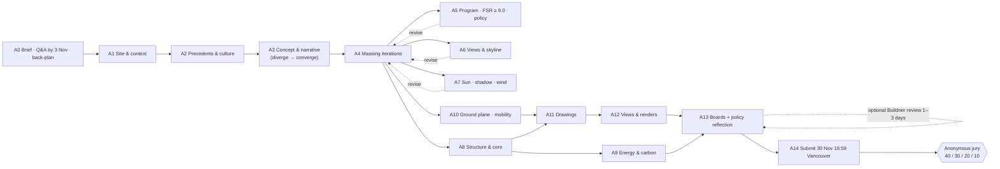
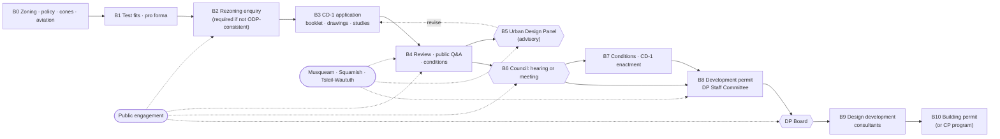

# Workflow study: two roles for Tower Design Toolkit

*Draft for Ruijie's review, Tue 27 Oct 2026. Stage 1 of the role-preset request: research only, nothing built. Single-pass research (team policy since 22 Oct): no second reader has checked it, so nothing below is marked "verified".*

**Ruijie's request (27 Oct):**
1. On opening, the user first picks a role, which loads a preset workflow:
   - (a) student designers entering the Vancouver Tall Challenge, a concept / ideas competition;
   - (b) designers of high-rise buildings in Vancouver practice.
2. Replace the left panel's evaluation on/off toggles with **design tools** that the user clicks into to work on the design. Each tool gets preliminary controls.

This document is the workflow study behind both changes. Section 9 holds the questions to answer before the interface is built. *Update 3 Nov:* §8a adds Vista's stepped flow and its live study strip (Ruijie approved item 8 on 3 Nov), with four more questions (§9, 10–13).

---

## How to read this

- **Brief's method, assignment p.3:** map each step: "who does it, with what input, producing what output". The study also marks where time goes, where errors happen, where work is handed over, and what has to stay a human judgment.
- **Source tags:**
  - `[VTC p.N]`: Vancouver Tall Challenge brief (English PDF in `03 Vancouver Tall Competition Brief/`), read locally on 27 Oct.
  - `[A2 p.N]`: ARCH 540 Assignment 2 brief.
  - `[C1]`–`[C14]`: City of Vancouver pages and PDFs, opened on 27 Oct. City servers return HTTP 403 to scripts, so these were read in the built-in browser; the list is in §10.
  - `[R1]`, `[R2]`: other sources opened on 27 Oct.
  - `[P17]`, `[P01]`, `[P03]`, `[P05]`, `[U1/U2]`: the team's own research packets (`04 Tool Plan/research/`), reused as they stand.
- **Evidence flags:**
  - ⬜ **unverified**: known only from a search summary, a secondary source or general practice knowledge, not from a page opened for this study;
  - 🟧 **team assumption**: the team's own reading or proposal;
  - **unmeasured**: a time nobody has measured;
  - **FALSE ASSUMPTION**: shown in magenta and kept visible next to its correction.
- **Node ids** are from `tower-studio/src/data/registry.ts`, the 29 built nodes, written without the `built.` prefix (e.g. `fsr` = `built.fsr`).

---

## 1. Summary

**1. The two roles share most of their *design* steps but run on different clocks and answer to different authorities.**
- **Students** have about 5 weeks (34 days from today to 30 Nov) and one anonymous jury [VTC p.25, p.27, p.32].
- **Practitioners** go through about a year of rezoning, from fee payment to public hearing [C2], then a development permit and a building permit. Their gates are owned by City staff, the Urban Design Panel, Council and the Development Permit Board [C1, C2, C5, C11].

**2. Students judge their own work against the jury weights.**
- The weights are human scale 40%, cultural context 30%, design 20%, urban integration 10% [VTC p.33].
- The team's as-is study found that ground level and cultural work are usually drawn last [P17, team assumption]. The student preset therefore moves both forward.

**3. Practitioners work to a published submission list.**
- The City's CD-1 rezoning guide (updated 1 Oct 2026) lists every study a tower needs [C3]:
  - view analysis;
  - shadow studies at the fall equinox (10 am, 12 pm, 2 pm and 4 pm PT);
  - sustainability reports;
  - a tower separation / block study;
  - a 3D model;
  - stats in metric **and** imperial;
  - a Higher Buildings Policy statement.
- Many of these map straight onto nodes the app already has. What is missing is a tool that **assembles** them into the package the City asks for.

**4. A real precedent exists for this height.**
- The Bay Parkade towers (271 m and 315 m) were applied for on 11 Jun 2025, reviewed by the Urban Design Panel on 4 Mar 2026 and approved after public hearings on 23 and 27 Jul 2026 [C6, C7].
- City staff told the Panel that the City has no established guidelines for towers of this height [C6]. That is the gap the VTC is exploring.

**5. Today's left panel is organised the wrong way for both roles.**
- It is organised by *evaluation*: 29 checks with on/off switches.
- Both workflows are organised by *design moves* (site, concept, massing, program, ground, views, core, envelope, drawings, boards), with checks *inside* each move.
- §6 proposes **15 shared design tools** that hold all 29 nodes, plus 2 tools for students and 6 for practitioners that don't exist yet.

**6. A false assumption to correct:** the submission deadline.
- **FALSE ASSUMPTION**: "30 Nov 23:59 London = 15:59 Pacific" [P17].
- London is on GMT in late November, so the deadline is 23:59 UTC. BC clocks have read UTC-7 all year since 8 Mar 2026 (BC Gov News 2026AG0013, cited in `engine/solar.ts`).
- **Correction:** 30 Nov, **16:59 on Vancouver clocks**.
- The app's Boards deadline uses the browser's time-zone data. On 27 Oct both the built-in browser and Node (tzdata 2026c) printed 16:59 for Vancouver, so the app is right here. A browser with older time-zone data would print 15:59. Only the P17 text needs correcting.

---

## 2. Workflow A: student designers entering the Vancouver Tall Challenge

### 2.1 The setting

| | What the brief says |
|---|---|
| **Kind** | An **ideas competition**. The jury may reward a creative breach of the guidelines if it is justified [VTC p.32]. The documents are "an academic exercise" and not legal documents [VTC p.36] |
| **Who may enter** | Open to all, no professional qualification needed. Individuals or teams of up to 4 [VTC p.36] |
| **Site** | A hypothetical full block in the CBD, about 79.2 × 144.8 m (260 × 475 ft). One or more towers. Context includes existing and approved future towers in the 244–305 m range [VTC p.15] |
| **Program** | A mix of uses. No overall FSR limit, but at least **9.0 FSR non-residential**, high-employment floor area. Public uses should extend vertically. A below-grade secondary transit entrance to the station next door. Servicing, loading and parking should be integrated [VTC p.16, p.19] |
| **Feasibility** | No budget. Show that you understand the link between density, public benefit and feasibility. Favour public value over "excessively expensive architectural expression" [VTC p.20] |
| **Deliverables** | 4 A2 landscape boards, each ≤ 10 MB, in English, with **no identifying information** [VTC p.27]. Up to 3 cover images: jpg, ≥ 2000 × 1680 px; the jury does not see them [VTC p.28]. A suggested set [VTC p.30]:  • diagrams: program, structure, form and massing;  • studies: wind, solar/shadow, sustainability;  • drawings: site plan, ground floor, typical lower, mid and upper plans, ≥ 2 sections;  • views: a skyline view from Queen Elizabeth Park, a mid-city view, ≥ 4 ground-level perspectives;  • a policy reflection |
| **Jury weights** | Human-scale experience 40, cultural context 30 ("City in Nature", reconciliation and Indigenous perspectives), excellence in design 20, urban integration and connectivity 10 [VTC p.33] |
| **Dates** | Registration closes 29 Oct. Q&A closes 3 Nov; later questions are not answered. Submission closes 30 Nov 23:59 London (= 16:59 Vancouver, see §1). Winners are announced 26 Jan 2027 [VTC p.25] |
| **Help on offer** | Optional Buildner preliminary review of draft boards, returned within 1–3 days [VTC p.31]. The brief advises researching the site and similar case studies [VTC p.32] |

**How ideas competitions are worked (general pattern):**
- Teams alternate between *divergent* idea generation and *convergent* agreement on one idea.
- Collaboration makes generating ideas easy and reaching consensus hard [R2: Erbil & Doğan 2012, interviews with three student teams; abstract only, so ⬜ for anything beyond that].
- Competition advice pieces stress three things: a single clear idea a tired jury grasps in seconds, reading the criteria closely, and uncluttered boards (⬜, commentary sites in the search results, not opened).
- The steps below follow the team's as-is workflow [P17] (built from the brief and the course demos), re-ordered to match Ruijie's list.

### 2.2 Step table (who, input → output, software, time)

| # | Step | Who | Input → output | Software (⬜ observed, not surveyed) | Time |
|---|---|---|---|---|---|
| A0 | **Brief, registration, back-plan** | Whole team; one person owns the checklist and calendar [P17] | Brief PDF, site plan, ground-level use plan, 3D model [VTC p.36], the two policy links [VTC p.9, p.13] → requirements checklist, Q&A list (before 3 Nov), roles, back-plan | PDF reader, shared drive, chat, spreadsheet [P17] | Unmeasured. 🟧 Back-plan [P17]: massing frozen ~9 Nov, studies ~16 Nov, plans and sections ~21 Nov, board drafts ~25 Nov, upload dry run ~28 Nov |
| A1 | **Site and context analysis** | Modeller (1–2) | Block and edges: arterial, retail high street, lanes, mid-block links, transit station, plaza [VTC p.15, p.18]; base model; City open data → oriented context model, true north, site diagrams (edges, access, sun, views) | Rhino or SketchUp; City open data [P17] | Unmeasured |
| A2 | **Precedent, cultural and geographic research** | All read; 1–2 lead the narrative [P17] | Precedent towers: the brief names Shangri-La, Paradox, Vancouver House, One Burrard Place, The Stack, The Butterfly [VTC p.9]; land acknowledgement [VTC p.3]; City engagement findings [VTC p.11–13]; Nation- and City-published sources → precedent sheet, cited narrative, design principles | Library and web, shared document, image boards [P17] | Unmeasured |
| A3 | **Concept and narrative** (diverge → converge) | Whole team, by consensus [R2] | Brief, A1, A2 → one concept statement, 2–5 directions, a core-idea diagram | Sketch, physical model, whiteboard ⬜ | Unmeasured |
| A4 | **Massing iterations** | Designers (2–3) and the modeller [P17] | Context, view envelope, 244–305 m band, program mix → 2–5 massing options, tagged by use if time allows | Rhino / Grasshopper, SketchUp, hand sketch; Forma or TestFit if licensed [P17] | Unmeasured; believed the largest share 🟧 [P17] |
| A5 | **Program, density and policy checks** | One person, often the least modelling-heavy [P17] | Areas off the model, mix, efficiency → GFA by use, non-residential FSR ≥ 9.0, area schedule, list of policy departures | Excel / Google Sheets [P17] | Unmeasured |
| A6 | **Views and skyline** | One designer and the modeller [P17] | View-cone polygons (City open data), the Queen Elizabeth Park reference photo → height envelope, skyline sketch, any intended breach with its reason | Rhino with imported cones, photomontage [P17] | Unmeasured |
| A7 | **Sun, shadow and wind studies** | The "environment" person, often self-taught [P17] | Massing, context, true north, weather → shadow images, sun-hour maps, a wind note | SketchUp / Rhino sun, Ladybug, Infrared.city, SimScale [P17] | Unmeasured |
| A8 | **Structure and core sketches** | A designer; most teams have no engineer [P17] | Massing, height, program, rules of thumb → structural strategy diagram, core layout | Hand sketch, Illustrator / CAD [P17] | Unmeasured |
| A9 | **Sustainability, energy and carbon** | Environment person plus one designer [P17] | Massing, envelope assumptions, weather → sustainability diagram, embodied-carbon estimate | Ladybug / Honeybee, spreadsheet, EC3 [P17] | Unmeasured |
| A10 | **Ground plane, public realm, mobility, servicing** | Designers [P17] | Edges, transit-entrance requirement, loading and parking → ground-floor plan, site plan, below-grade link, servicing diagram | Rhino / CAD plans, Photoshop collage [P17] | Unmeasured |
| A11 | **Drawings** | 2 members with the modeller [P17] | Frozen massing, cores, ground plan → site plan, ground, typical lower, mid and upper plans, ≥ 2 sections [VTC p.30] | Rhino Make2D, Illustrator / AutoCAD, Revit if used [P17] | Unmeasured |
| A12 | **Visualisation** | 1–2 members [P17] | Final model, cameras → QEP skyline view, mid-city view, ≥ 4 ground perspectives [VTC p.30] | Enscape, Twinmotion, Lumion, V-Ray, Photoshop; AI image tools with caution [P17] | Unmeasured; re-rendering after changes is a known cost [P17] |
| A13 | **Boards and policy reflection** | 1–2 board designers; whole team reviews [P17] | All of the above → 4 A2 boards (≤ 10 MB, English, anonymous) [VTC p.27], policy reflection [VTC p.30], optional Buildner review (1–3 days) [VTC p.31] | InDesign, Illustrator, Affinity, Figma, Canva [P17] | Unmeasured; a last-week crunch [P17] |
| A14 | **Submit** | Team lead [P17] | Boards, cover images, member details → entry uploaded before the deadline [VTC p.25, p.27, p.28] | Buildner upload panel [VTC p.27] | Unmeasured |

### 2.3 Pain points, hand-overs, and what stays a human judgment

| # | Pain points and errors | Hand-over | Can be delegated (code, or AI with citations) | Stays with people | Jury tag |
|---|---|---|---|---|---|
| A0 | Obligations are scattered across the brief and two policy documents. Ambiguities (FSR basis, height measure, cones on a hypothetical site) must be asked before 3 Nov [P17]. The deadline was converted with the wrong offset (see §1) | Reading notes in chat | Extract dates, numbers and deliverables; flag contradictions in the brief [P17, demo D] | What to prioritise. How to read "City in Nature" and reconciliation. Which guideline to breach [VTC p.32] | all |
| A1 | The supplied model's north is 45° off and its saved location is Richmond (first attempt, `PROJECT_OVERVIEW.md` §2). Units come in ft and m [P17] | Model file by drive; versions drift [P17] | Import, units, orientation, areas | Which context matters | urban 10 |
| A2 | Carries 30% of the weight but is often compressed late 🟧. Risk of generic or placeless motifs [VTC p.19, p.33]. Citations must not identify the team | Narrative reaches the boards late; principles rarely reach the massing [P17] | Retrieval, summaries, citation bookkeeping | **Interpreting Indigenous perspectives, what to represent, any engagement. No tool speaks for a Nation** (`PROJECT_OVERVIEW.md` §0 rule 4) | cultural 30 |
| A3 | Agreeing on one idea is the hard part [R2]. Options get narrowed too early (pain point c) | Sketches to modellers | Recording decisions and options | The concept itself | design 20 |
| A4 | Options are compared by eye; areas are recomputed by hand after every change; the option count is limited by modelling time [P17] | Screenshots or copied files to the spreadsheet person | Generating and measuring variants | Form, silhouette, expression | design 20, cultural 30 |
| A5 | Copying from model to sheet drifts. 🟧 11,468 m² × 9.0 ≈ 103,200 m² non-residential if the whole block is the FSR basis (unconfirmed) [P17]. The Higher Buildings Policy names about 550–700 ft (≈ 168–213 m) as the highest in the CBD [P05], below the brief's 244–305 m band, so the policy reflection matters | Numbers to boards; boards later disagree with the model | Take-off, FSR, floors versus height, consistency | Mix, efficiencies, what counts as high-employment | design 20 |
| A6 | Cone heights are not in the open data; policy PDFs are hard to reach; checked late, a massing may need rework [P17] | Envelope to massing; skyline view to rendering | Clipping against cones where parameters exist | Breaching on purpose; skyline composition | cultural 30, design 20 |
| A7 | Run once on the final option, not to compare. Pictures without a criterion. Wind is the study most often skipped [P17] | Images to boards; rarely fed back | Sun hours, shadow areas, wind screening | Which criterion and day; what is acceptable | human scale 40 |
| A8 | Core and structure sizes are rules of thumb; the core in the spreadsheet and in the plans disagree [P17] | Core areas back to the sheet by hand | Preliminary sizing from sourced rules | Structural concept and its expression | design 20 |
| A9 | Targets unsourced; envelope and systems are invented; reduced to a diagram late [P17] | Diagram to boards | Weather, radiation, simple energy, EPD look-ups | Strategy and trade-offs | design 20 |
| A10 | Where human scale (40%) is decided, yet often drawn last 🟧. Loading, parking and the transit link are coordinated by eye [P17] | Plans to renderings | Clearances, counts, path lengths | Public-space quality, entrances, cultural expression | human scale 40, urban 10 |
| A11 | Plans redrawn after every change; cuts chosen late; labels disagree with the sheet [P17] | PDFs or AI files to the board designer | Plan and section extraction, area labels | Which cuts, drawing conventions | design 20 |
| A12 | Re-rendering after changes; placing the skyline camera. The competition page warns AI-generated images may carry ownership restrictions and are not advised as sole original work [P17] | Images to layout, kept under 10 MB | Camera set-up from coordinates, batch renders | Composition and story | human scale 40, cultural 30 |
| A13 | Everything arrives late in mixed formats; numbers drift; file names or metadata can break anonymity 🟧 [P17] | Everything converges here | Number sync, size and metadata checks | Narrative, hierarchy, emphasis | all |
| A14 | Time-zone confusion (see §1), upload failure, size limit [P17] | Files to the portal | Pre-flight (size, metadata, dimensions) | The decision to submit | — |

---

## 3. Workflow B: designing a high-rise in Vancouver practice (feasibility → permit)

### 3.1 The setting

- **Phases of service.** The RAIC *Canadian Handbook of Practice* splits a project into predesign, schematic design, design development, construction documents, construction procurement, contract administration, and take-over / commissioning / post-occupancy [R1, chapter titles only].
- **The City's approval path.** Area plans and policies come first, then five rezoning steps (pre-application and enquiry, application, report writing, Council decision, zoning enactment), then the development and building permits [C1].
- **Why a tower this tall needs a rezoning.** Downtown sites in the Higher Buildings Policy's Figure 1 that seek significant extra height, or that enter the Queen Elizabeth Park or other Council-approved view corridors, must show how the proposal meets the policy [C3 §4.11]. Under the policy, the proposal must:
  - set a significant new benchmark for architectural excellence and carbon neutrality;
  - leave a lasting public legacy, such as community benefits, observation decks or open space;
  - mitigate adverse microclimate effects;
  - minimise shadow and view impacts on key streets, parks, plazas and neighbours.
- **Policy is changing.** The Higher Buildings Policy Review expects draft policies in fall 2026 – winter 2027 and adoption in spring 2027 [P01-S03]. The VTC feeds into it [VTC p.13, p.34].
- **Large-site rules apply to the VTC block.** The Rezoning Policy for Sustainable Large Developments applies at a site of 8,000 m² or more, or at 45,000 m² or more of new floor area [C3]. The VTC block (≈ 11,468 m²) qualifies [P05].

### 3.2 Step table (who, input → output, software, time)

| # | Step (RAIC phase) | Who | Input → output | Software (⬜ general practice, not surveyed) | Time |
|---|---|---|---|---|---|
| B0 | **Site, zoning and policy analysis** (predesign) | Developer, architect; ⬜ land-use lawyer or planner | Zoning district; is there policy support? If the zoning already allows the project → a development permit, not a rezoning [C2 steps 1–2]. HBP site test [C3 §4.11]. View cones (City View Cone Assessment through Van311, ⬜ from past replies). Aviation: NAV CANADA land-use review [P01] → constraint envelope, pathway, go / no-go | City open data and maps, Rhino, Excel ⬜ | Unmeasured. NAV CANADA replies in 8–12 weeks, 12–18 months if mitigations are needed [P01-S25] |
| B1 | **Massing test fits and pro forma** (predesign) | Developer, architect, ⬜ cost consultant, land economist | Constraint envelope, market → options, GFA, residual land value under existing zoning vs. after rezoning [C3 §5.5]; Class C cost report by a certified cost professional where a CAC is negotiated [C3 §5.6]; CAC offer [C3 §5.4]; DCL and ACC are building-permit conditions [P01-S32, S33] | Rhino / Revit, Excel pro forma ⬜ | Unmeasured |
| B2 | **Rezoning enquiry** | Architect and developer with rezoning staff and management [C2] | Early proposal → advice. Three formats: a 50-min meeting, an 80-min workshop, or a Letter of Response stating the degree of support [C2]. **Required** when the proposal is inconsistent with an ODP or departs significantly from policy (DAP By-law s.2.2) [C2]. Staff may ask for a pre-application open house [C1] | Booklet (PDF) | Meeting 50 min, workshop 80 min [C2]. Enquiries inactive for 6 months may be cancelled [C4]. Precedent: a rezoning-advice application for the Bay Parkade site in Dec 2019 (⬜ search summary) |
| B3 | **Rezoning application (CD-1)** (schematic design) | Architect coordinates; consultants named by the City [C3]: BC land surveyor, solicitor, professional engineer (water and fire flow), environmental consultant, sustainability / energy, hydrogeologist, transportation consultant (TAMS), ISA arborist, heritage, certified cost professional; ⬜ wind and structural consultants | **Rezoning booklet** (11×17, metric **and** imperial) [C3 App. B]:  • context map (two-block radius), zoning and policy context;  • view analysis, sustainability measures, HBP summary;  • tower separation / block study;  • stats, drawings;  • shadow studies for buildings over 11 m, fall equinox at 10 am, 12 pm, 2 pm and 4 pm PT;  • 3D model near parks;  • renderings with diverse scale figures;  • FSR overlays.  **Drawings** at 1:200 [C3 App. C]. **Studies** [C3 §4]:  • green and resilient package (embodied-carbon design report, resilient-buildings worksheet, commissioning and sub-metering commitment);  • TAMS and hydrogeology (large sites);  • the HBP materials;  • the large-developments package.  Then fee → a rezoning planner is assigned | Revit / Rhino, Adobe, energy and LCA tools, Excel ⬜; the City asks for Excel and PDF formats [C3 §4.4] | **About one year from fee payment to public hearing**, varying with complexity and revisions [C2]. Building grades: apply early because of wait times [C3 §3.1] |
| B4 | **Application review and public consultation** | Rezoning planner, City departments, public; for larger or non-ODP applications also the UDP, advisory committees, school boards, **Local Nations**, Metro Vancouver, TransLink, the Province [C2] | Application → site sign, postcards, Shape Your City page and online Q&A [C1, C2]; technical review of the statistics, which informs the FSR and height in the new zoning [C2] → **rezoning conditions**: consolidation, servicing, CAC or in-kind amenity, land dedication, form-of-development changes [C2]. The applicant agrees to them in principle | Shape Your City, PDF | Precedent: Q&A 19 Nov – 2 Dec 2025 [C7] |
| B5 | **Urban Design Panel review** | UDP (advisory; it does not approve or refuse, and is not a forum for public input) [C5]; architect and landscape architect present [C6] | Project booklets, virtual 3D model(s), video flythrough, plan set, boards [C3 §6.2] → panel vote and recommendations. Precedent, 4 Mar 2026 (271 m and 315 m towers): staff asked about urban integration, the plaza, tower separation above about 600 ft, supertall performance (wind, structural expression, sustainability systems, constructability, maintenance) and the skyline. The panel voted "support with recommendations" 9–0; recommendations included more separation, a podium more responsive to the street, more uses, visible sustainability, "deeper ways to indigenize" and the heritage façade [C6] | Booklet, model, flythrough | One meeting; the 4 Mar 2026 session reviewed both linked applications together [C6] |
| B6 | **Referral report → Council decision** | Rezoning planner, City Clerk, Council, public [C1, C2] | Report: analysis, feedback summary, conditions, draft CD-1 by-law [C2]. Pathway [C4]:  • consistent with an ODP and > 50% residential → decided at a Council meeting (public hearings are prohibited);  • consistent and < 50% residential → Council chooses a hearing or a meeting;  • inconsistent, or no ODP → public hearing.  Council approves, amends or refuses [C1] | — | Precedent: referred 14 Jul 2026; hearings 23 and 27 Jul 2026; approved [C7] (7–3 vote, P01 news) |
| B7 | **Conditions and enactment** | Applicant, City lawyers, Council [C1, C2] | Legal agreements, CAC payment → Council enacts the CD-1 by-law [C1, C2] | — | "Usually … in the months after" approval [C1] |
| B8 | **Development permit** (design development) | Architect, landscape architect, consultants; development planner; DP Staff Committee; **DP Board** for major projects [C11] | Optional DP enquiry on discretionary items [C8, C10]. Application [C9]:  • design and relaxation rationale, *with responses to the rezoning conditions*;  • technical data summary, FSR compliance plans;  • landscape drawings, context plan;  • shadow study (Downtown: basic or detailed fall-equinox study under the Solar Access Guidelines);  • view protection analysis including skyline impacts;  • block study (tower separation);  • 3D model [C8].  Board: four senior staff plus an advisory panel; the public may speak; the Board cannot refuse a compliant permit or approve a non-compliant one [C11] → DP issued once conditions are met | Revit, Rhino, Adobe ⬜ | No published figure for towers. Multi-family and mid-rise DPs averaged 9.8 months in 2025 [C14] (not towers). The DP can be applied for after approval in principle but is issued only after enactment [C2]. The BP must be applied for within 12 months [C8] |
| B9 | **Consultant coordination and design development** | Architect and consultants: structure, MEP, ⬜ vertical transportation, ⬜ code and fire, building-envelope professional [C9], energy modeller, landscape | Models and drawings → coordinated design. Energy to the Vancouver Building By-law limits (Green Buildings Policy: on track for the VBBL limits at first building permit, ⬜ 2022 bulletin search summary); embodied carbon [C3 §4.4]; rainwater management moved to the building-permit stage [C14] | Revit / BIM, structural analysis, energy-modelling and LCA software ⬜ | Unmeasured |
| B10 | **Building permit** (construction documents) | Architect and engineers of record; optionally a **Certified Professional** [C13]; City reviewers | Complete application only [C12] → review conditions; alternative solutions where the by-law intent is met another way [C12] → permit; trade permits; inspections. The CP route allows staged permits so construction can start earlier [C13] | Revit / CAD ⬜ | Unmeasured; work must start within 6 months of issue [C12] |

**Threads that run alongside B2–B8:**

| Thread | What happens | Source |
|---|---|---|
| **Public engagement** | Pre-application open house if staff ask (B2). Site sign, postcards, Shape Your City Q&A (B4). Written comments and speakers at the hearing (B6). Speakers at the DP Board (B8) | [C1, C2, C4, C11] |
| **Musqueam, Squamish and Tsleil-Waututh** | "Local Nations" are on the City's list of consultees for larger applications [C2]. The UDP recommended deeper Indigenous integration "beyond surface-level gestures", into process, employment and long-term engagement [C6]. ⬜ A City engagement guide for rezoning and DP applicants (DP Board, 11 May 2026, Appendix N) sets minimum standards and asks for an engagement summary before the DP decision (search summary only; the PDF is scanned images and could not be read). ⬜ The City's UNDRIP Strategy (Oct 2022) and its 2024–2028 action plan (search summary) | [C2, C6], ⬜ |
| **Other agencies** | NAV CANADA land-use review and Transport Canada marking and lighting [P01]; TransLink, Metro Vancouver and the Province where relevant [C2]. TransLink publishes no station-connection guidance that the team could find [P01-S70] | [P01, C2] |

### 3.3 Pain points, hand-overs, and what stays a human judgment

| # | Pain points and errors | Hand-over | Can be delegated | Stays with people |
|---|---|---|---|---|
| B0 | Policy is spread across ODPs, the HBP, the Public Views Guidelines and bulletins, and many City PDFs can't be fetched by scripts [P01]. No published guidelines exist for towers of this height [C6] | Feasibility memo to the client | Zoning and policy look-ups with citations; cone and aviation screens; site-area tests (large-site trigger) | Whether to pursue a rezoning; risk appetite |
| B1 | Pro forma assumptions are commercial and unsourced 🟧; the CAC is negotiated where it applies [C3 §5.5] | Numbers to the client and the QS | Area take-off, residual arithmetic, charge look-ups | Price, mix, the CAC offer |
| B2 | The enquiry is required for this kind of project but the enquiry package has no fixed contents in the guide 🟧 | Booklet to staff | Assembling a short booklet from the model | What to ask, what to concede |
| B3 | The list is long, conditional and changes often ("review immediately before submitting") [C3]. Every study has its own consultant and format. Stats must match across booklet, drawings and studies, in two unit systems [C3] | Many consultant reports into one package | **Applicability logic** (which items apply); stats in metric and imperial; shadow sheets at the City's four times; FSR overlays; completeness checks | Design rationale, relaxations sought, the public-benefit offer |
| B4 | Iteration under conditions; revisions lengthen review [C2] | Responses to staff comments | Diffing revisions; re-running checks | Agreeing to conditions |
| B5 | Qualitative advice; no tower-height guidelines yet [C6] | Advice back to the design team | Preparing evidence for the panel's usual questions (separation, skyline views, ground plane, performance) | The panel's judgment; the design response |
| B6 | Political decision; pathway depends on ODP consistency and the residential share [C4] | Report to Council | Computing the residential share that sets the pathway | Council's vote |
| B7 | Legal agreements take months [C1] | Lawyers | Condition tracking | Signing agreements |
| B8 | Conditions from rezoning carry into the DP; the drawing set must show every FSR exclusion [C9] | DP set to the development planner and the Board | FSR compliance plans, shadow and view analyses, block study geometry | The Board's decision; design quality |
| B9 | Coordination across many consultants; changes ripple 🟧 | Models between consultants ⬜ | Clash and consistency checks; energy and carbon screening | Engineering judgment and professional responsibility |
| B10 | Incomplete applications are refused intake [C12] | Permit set to the City or a CP | Completeness pre-checks | Sealing the drawings; alternative solutions |

---

## 4. Comparison

### 4.1 Where they differ

| | **A: students (VTC)** | **B: Vancouver practice** |
|---|---|---|
| Goal | Win or place, by persuading an anonymous jury [VTC p.32–33] | An approved, buildable, financeable building |
| Authority | The brief, "an academic exercise and … not legal documents" [VTC p.36] | By-laws, ODPs, policies, Council, DP Board [C1, C11] |
| Clock | About 5 weeks left (34 days from 27 Oct) [VTC p.25] | About 1 year to a public hearing [C2]; precedent ≈ 13.5 months application → approval [C7]; then DP, BP |
| Team | ≤ 4 people, no engineers on most teams [VTC p.36, P17] | Architect plus a dozen named consultant roles [C3] |
| Site | Hypothetical block; base model supplied [VTC p.15, p.36] | A real titled site: survey, title, grades, environmental disclosure [C3 §2–4] |
| Height | 244–305 m band [VTC p.19] | HBP: about 550–700 ft (≈ 168–213 m) as the highest in the CBD [P05]. The 315 m precedent went through a site-specific rezoning [C6, C7] |
| Program | ≥ 9.0 FSR non-residential, no overall FSR cap [VTC p.19] | FSR set in the CD-1 by-law after technical review [C2] |
| Money | No budget; show the link between density and public benefit [VTC p.20] | Pro forma, CAC, DCL, ACC, Class C cost [C3, P01] |
| Review | One jury moment, anonymous; justified breaches may be rewarded [VTC p.32] | Iterative staff review, UDP advice, public input, Council vote [C1, C2, C5] |
| Culture and Nations | 30% of the jury weight [VTC p.33] | Local Nations among the consultees [C2]; the UDP pushes for deeper integration [C6] |
| Output | 4 A2 boards + cover images [VTC p.27–28] | Booklet, 1:200 drawings, studies, 3D model, flythrough, DP set, BP set [C3, C8, C9] |
| Units | Metric with feet in the brief [VTC p.15] | **Metric and imperial required** in the booklet and drawings [C3 App. B, C] |
| Shadow study | "Solar / shadow studies", unspecified [VTC p.30] | Fall equinox at 10 am, 12 pm, 2 pm, 4 pm PT for buildings over 11 m [C3]; basic or detailed studies under the Downtown solar guidelines [C9] |
| Wind | "Wind studies" [VTC p.30] | HBP: "mitigating adverse microclimate effects" [C3 §4.11]; no numeric City wind criterion found [P03]; wind raised by the UDP [C6] |
| Energy | "Sustainability and environmental performance" [VTC p.30] | Green and resilient package at rezoning [C3 §4.4]; VBBL limits at BP ⬜ |

### 4.2 Where they share steps

| Shared design move | A step | B step | Note |
|---|---|---|---|
| Site and context | A1 | B0 | Same data (City open data); B adds survey and title |
| Precedents and culture | A2 | B4 thread | A treats it as research for a narrative; B treats it as engagement with Nations |
| Massing | A4 | B1, B3 | Same geometry; B ties it to a pro forma |
| Program and density | A5 | B1, B3 stats | Same take-off; different rule sets |
| Views and skyline | A6 | B0, B3, B8 view analysis | Same cone geometry; B needs the City's own assessment |
| Sun and shadow | A7 | B3, B8 shadow studies | B fixes the dates and times; A doesn't |
| Wind | A7 | B3 (HBP microclimate), B5 | Both qualitative in Vancouver today |
| Structure and core | A8 | B9 | A sketches; B engineers |
| Energy and carbon | A9 | B3, B9 | B has required reports |
| Ground plane and mobility | A10 | B3 (TAMS, landscape), B8 | Both: below-grade link, loading, frontage |
| Drawings | A11 | B3, B8, B10 | Same plans and sections at different scales |
| Visualisation | A12 | B3 renderings, B5 flythrough | Both need scale figures and labelling |
| Presentation | A13 boards | B3 booklet, B5 boards | Different formats, same assembly problem |
| Policy argument | A13 policy reflection | B3 HBP summary and rationale | The same question, argued for a jury or for the City |

**The core finding:** about 12 design moves are common to both roles. The roles differ in order, in what each step must produce, and in who checks it. One set of design tools, ordered per role, is enough. A few tools belong to one role only: concept and research for students; the policy pathway, the rezoning package, design-review prep, consultant hand-off and permit readiness for practice.

---

## 5. Workflow diagrams

### 5.1 Workflow A: VTC student team (≈ 5 weeks)

### 5.2 Workflow B: Vancouver practice (rezoning → permits)

Hexagons are gates owned by someone outside the design team. Dotted lines are threads and loops.

---

## 6. What the app already supports, and the design tools it's missing

### 6.1 Proposed design tools (shared catalogue)

Each tool is a **design move**. The user works in it; the evaluation nodes listed become **results inside the tool**, with their evidence flags, rather than switches in the left panel. Every one of the 29 built nodes has a home.

| Tool (icon + word) | What the user does in it | Existing controls today | Results inside (nodes) | Status |
|---|---|---|---|---|
| **1. Brief & plan** | Read the brief or project brief as a checklist; dates and back-plan; Q&A log | — (deadline gate in Boards) | `vtc-rules` | **Partial**: the checklist, back-plan and Q&A log are missing |
| **2. Site & context** | Pick a project or site; context layers; ground follows terrain; hide existing buildings | Project tabs, Context layers, ground card (Real Vancouver) | `relax-aviation` (aviation part) | **Partial**: no site-analysis diagrams (edges, access, sun) for the boards |
| **3. Massing** | Towers, podium, height, plate, rotation; import a model; options | Design tab: Towers, Massing; Import; Options page | `vtc-rules` (height band) | **Exists**; richer forms (taper, setbacks, several volumes) missing |
| **4. Program & value** | Program bands by use, public uses up the tower, value | Design tab: program bands; economics ledger | `fsr`, `economics`, `sky-room` | **Exists**; drag-to-stack program diagram missing |
| **5. Views & skyline** | Cone envelope, views from places and from cones, skyline frames | Vista panel, View from here, relaxation masks | `viewcones`, `vista`, `view-from`, `relax-aviation` | **Exists**; a ready QEP skyline frame for the board missing |
| **6. Ground & public realm** | Streetwall, frontage, open space and links, loading and parking, station entrance | Public realm inputs, site access plan | `pr-streetwall`, `pr-frontage`, `pr-ground`, `mobility`, `trips` | **Partial**: checks exist; drawing the ground plan (entries, plaza, lanes) is missing |
| **7. Sun, shadow & wind** | Sun clock and day, City solar test, solar envelope, wind screen | Solar panel, envelope overlay, wind overlay | `sun`, `solar-access`, `wind-study`, `wind-screen` | **Exists** |
| **8. Core & floors** | Core sized to the lifts, sky lobbies, plant floors, stairs, floor layouts | Design tab: Schematic block; lift and egress presets | `core-lifts`, `egress`, `life-safety`, `interior`, `daylight-depth` | **Exists** |
| **9. Structure** | Structural system, outriggers, slenderness | Structure panel, outrigger picker | `structure`, `wind-procedure` | **Exists** |
| **10. Facade & envelope** | Glazing ratio, bird-friendly treatment, unrolled elevations | Facade ledger | `facade` (+ `daylight-depth` read here too) | **Exists** |
| **11. Energy, carbon & nature** | Energy and carbon estimate, PV, rainwater, birds, planting | Energy inputs, nature ledger | `energy-carbon`, `city-in-nature` | **Exists** |
| **12. Culture & engagement** | Claims guard, engagement log, AI-use log | Culture and provenance ledgers | `culture-claims`, `provenance` | **Partial**: guardrails only (by design: nothing speaks for a Nation) |
| **13. Drawings** | Plans, section A–A, elevations at a scale | Drawings viewer, board plan | — (the drawings are evidence) | **Exists** |
| **14. Visualise** | Camera presets, captures, AI render (labelled) | Present: representation, camera presets, capture, AI render | — | **Exists**; the board's suggested view list (QEP skyline, mid-city, 4 ground views) isn't a checklist yet |
| **15. Boards & submit** | Compose 4 A2 boards; anonymity, size and metadata checks; deadline | Boards composer and checks | — (board checks are their own results) | **Exists** |

**Tools that don't exist yet:**

| New tool | For | What it would do | Reuses |
|---|---|---|---|
| **16. Research & precedents** | A (student) | A cited precedent board: towers with height and use (could read Real Vancouver's LiDAR heights for local towers), cultural and geographic sources | Sources hub, culture guard |
| **17. Concept & narrative** | A | Concept statement, 3–5 principles, each linked to the design moves and checks that show it; feeds the policy reflection | Trace (human decisions), Options |
| **18. Policy & zoning pathway** | B (practice) | Zoning district, ODP consistency, HBP Figure 1 site test, large-site trigger, residential share → which path (DP or rezoning; hearing or meeting) | `relax-aviation`, P01 research (not built) |
| **19. Rezoning package** | B | The City's CD-1 list [C3] as an applicability checklist; booklet stats in metric and imperial; shadow sheets at the City's four times; FSR overlays; 3D model export | `fsr`, `solar-access`, `viewcones`, `energy-carbon`, `mobility`, Export |
| **20. Design review prep** | B | The UDP's usual questions [C6] → an evidence pack: separation, skyline views, ground plane, performance | Options, Vista, all checks |
| **21. Consultant hand-off** | B | A brief per consultant (structure, MEP, VT, wind, energy, transport) with the model and the numbers they need | Export, Sources hub |
| **22. Permit readiness** | B | The DP checklist [C9] and BP intake items [C12] as checklists tied to the model | Drawings, FSR |

### 6.2 Step-by-step coverage

| Step | Tools | Covered today | Missing |
|---|---|---|---|
| A0 / B0 | 1 Brief & plan / 18 Policy & zoning | `vtc-rules`, deadline; cones and aviation | Brief checklist, back-plan, Q&A log; the pathway tool |
| A1 | 2 Site & context | Both projects, layers, terrain | Site-analysis diagrams |
| A2 | 16 Research & precedents, 12 Culture | Guards only | Precedent board |
| A3 | 17 Concept & narrative | Trace, Options | Concept tool |
| A4 / B1 | 3 Massing, 4 Program & value | Massing, import, options, `economics` | Richer forms; existing-vs-rezoned residual |
| A5 | 4 Program & value | `fsr`, `vtc-rules`, `economics` | Policy-reflection helper |
| A6 | 5 Views & skyline | `viewcones`, `vista`, `view-from` | QEP board frame |
| A7 | 7 Sun, shadow & wind | `sun`, `solar-access`, `wind-*` | — |
| A8 / B9 | 8 Core & floors, 9 Structure | `core-lifts`, `egress`, `life-safety`, `structure`, `wind-procedure` | Consultant hand-off (B) |
| A9 | 11 Energy, carbon & nature | `energy-carbon`, `city-in-nature` | — |
| A10 | 6 Ground & public realm | `pr-*`, `mobility`, `trips` | Ground-plan drawing tool |
| A11 | 13 Drawings | Drawings | — |
| A12 | 14 Visualise | Camera presets, AI render | Suggested-view checklist |
| A13–A14 | 15 Boards & submit | Composer, anonymity, size, metadata | Policy-reflection text frame; a note that older browsers may show the deadline an hour early (§1) |
| B2–B3 | 19 Rezoning package | Most of the studies as checks | The package itself, units in both systems (Phase 1 item 7) |
| B5 | 20 Design review prep | Options, views | The prep tool |
| B8, B10 | 22 Permit readiness | Drawings, FSR | The checklists |

---

## 7. Proposed presets (ordered design tools)

The order is the team's reading of each workflow 🟧. The user can reorder or hide tools, and switch role later. "Results inside" stay on for every tool in the preset; nothing is switched off to save time.

### 7.1 Student · Vancouver Tall Challenge

| Order | Tool | Why here |
|---|---|---|
| 1 | Brief & plan | Q&A closes 3 Nov; the deliverables shape everything [VTC p.25, p.30] |
| 2 | Site & context | A1 |
| 3 | Research & precedents *(new)* | The brief asks for site and case-study research [VTC p.32]; cultural context is 30% [VTC p.33] |
| 4 | Concept & narrative *(new)* | Converge on one idea before modelling [R2] |
| 5 | Massing | A4 |
| 6 | **Ground & public realm** | Moved forward on purpose: human scale is 40% and it is usually drawn last [VTC p.33, P17] 🟧 |
| 7 | Program & value | FSR ≥ 9.0 non-residential; public uses up the tower [VTC p.19] |
| 8 | Views & skyline | The QEP skyline view is a required visual [VTC p.30] |
| 9 | Sun, shadow & wind | Performance studies [VTC p.30] |
| 10 | Core & floors | Feasibility [VTC p.19–20] |
| 11 | Structure | "Structural strategy" diagram [VTC p.30] |
| 12 | Facade & envelope | Design excellence; bird safety |
| 13 | Energy, carbon & nature | Sustainability study; Sustainability Award [VTC p.21, p.30] |
| 14 | Culture & engagement | Guardrails before anything goes on a board |
| 15 | Drawings | The plans and sections in the suggested set [VTC p.30] |
| 16 | Visualise | Skyline, mid-city, 4 ground views [VTC p.30] |
| 17 | Boards & submit | 4 A2 boards, anonymous, ≤ 10 MB [VTC p.27] |

### 7.2 Practitioner · Vancouver high-rise

| Order | Tool | Why here |
|---|---|---|
| 1 | Site & context | B0 |
| 2 | Policy & zoning pathway *(new)* | Decides DP vs. rezoning and the Council pathway [C2, C4] |
| 3 | Views & skyline | Cones and the HBP view test come early [C3 §4.11] |
| 4 | Massing | B1 |
| 5 | Program & value | Pro forma, CAC, DCL, ACC [C3, P01] |
| 6 | Sun, shadow & wind | Shadow studies at the City's times; HBP microclimate [C3] |
| 7 | Ground & public realm | Landscape and public realm, TAMS on large sites [C3] |
| 8 | Core & floors | Feasibility of the plate |
| 9 | Structure | Supertall technical factors raised by the UDP [C6] |
| 10 | Energy, carbon & nature | Green and resilient package [C3 §4.4] |
| 11 | Facade & envelope | Bird-friendly guidelines; envelope professional at DP [C9] |
| 12 | Culture & engagement | Local Nations and public consultation [C2] |
| 13 | Rezoning package *(new)* | B2–B3 |
| 14 | Design review prep *(new)* | B5 |
| 15 | Drawings | Booklet and DP set |
| 16 | Visualise | Renderings with diverse scale figures; flythrough [C3] |
| 17 | Consultant hand-off *(new)* | B9 |
| 18 | Permit readiness *(new)* | B8, B10 |

*Boards & submit* stays in the practitioner catalogue, hidden by default. UDP boards [C3 §6.2] can reuse the composer.

---

## 8. Interface outline for Stage 2 (for discussion, not built)

1. **"Who are you?" screen.**
   - Two cards: **Student · Vancouver Tall Challenge** and **Practitioner · Vancouver high-rise**, plus "Just exploring", which keeps the current library.
   - The choice is stored (like `ts.landing.skip`) and can be changed from the top bar.
   - The existing landing page (`#/start`) keeps its two doors, Guided and Customize. The role decides which preset Guided opens with.
2. **Left panel = design tools in preset order.**
   - Each row: icon + word, a short line saying what you do there, and a results summary (e.g. "3 pass · 1 check · 1 unknown", with flags).
   - Clicking a row opens the tool, with its controls and its results inside.
   - Each tool has a home stage (Massing, Schematic or Present): tools 1–7, 12 and 16–18 → Massing; 8–11 → Schematic; 13–15 and 19–22 → Present. Opening a tool moves to its stage with the existing stage motion (and reduced motion).
3. **Evaluations stay available but are not the primary control.**
   - Results live inside each tool, with evidence flags.
   - An "All checks" drawer (today's toggle list) remains for Customize users and for power users.
4. **DESIGN_HANDOFF rules apply:**
   - stage palettes;
   - icon + word, never colour alone;
   - flags visible;
   - motion tokens and reduced motion;
   - axe-clean;
   - keyboard: arrow keys move through the tools and Enter opens one.

### 8a. Stepped flow and study strip, from Vista v34 (added 3 Nov)

*Ruijie approved this element on 3 Nov (`04 Tool Plan/TODAY_2026-11-03.md`, item 8). It belongs to Stage 2, so it still waits for approval of this study. Source: Vista v34, github.com/RuijieLiu6/vancouver-tall-view-tool, read only via `gh api` on 3 Nov: README §2, `explorer/index.html`, `explorer/explorer.js`.*

**What Vista does:**
- **Four steps:** Site → Build → View → Output, on a rail at the top of the panel.
  - Each step button shows an icon, its number and name, and a status pill: Site "Not set / Set"; Build "None" or the height; View the viewpoint; Output "Ready / Not yet".
  - The current step, finished steps and locked steps are drawn differently.
- **Methods.** Each step opens with a question ("How do you want to choose where your building goes?") and method cards:
  - Site: *Open spot on the plan*, *Replace a building*, *Replace several buildings*;
  - Build: *Build on the platform*, *Upload model*;
  - View: *Protected view cone*, *From a building*, *From the street*, *Drag and view*.
  
  After a choice, the other methods stay available as switch buttons. Switching clears that step's result.
- **Moving on.** Proceed and Return (Back) sit at the foot of the panel. A line says what is still needed (e.g. "Place a site on open ground to continue."). When a step's work is done, an inline confirmation appears ("✓ Site placed · Proceed to Build ›").
- **Unlocking.** Steps unlock in order: a step can be reached only when every earlier step is complete. Output says that its results update live when you go back and edit earlier steps.
- **Accessibility.** On every step change, keyboard focus moves to the new step's heading.
- **Examples.** "Start from a real tower" loads a complete worked study (Shangri-La, Vancouver House, The Butterfly).
- **Summary strip.** "Study at a glance" sits above the map: Height, Site, Plan overlaps, Demolished, Viewpoint, View height cap, Your ceiling.
  - **?** at the end opens a region explaining each number. Esc closes it and returns focus.
  - Values Vista can't support read "Unavailable" rather than guessing.

**How it folds into the role presets (proposal 🟧):**

1. **The role's tools become 5 steps on a rail at the top of the left panel,** as in Vista. The order inside each step is the preset order from §7.

   | Step | Student · VTC | Practitioner · Vancouver high-rise |
   |---|---|---|
   | 1 | **Brief & site:** Brief & plan, Site & context, Research & precedents | **Site & policy:** Site & context, Policy & zoning pathway, Views & skyline |
   | 2 | **Concept:** Concept & narrative | **Feasibility:** Massing, Program & value |
   | 3 | **Build:** Massing, Ground & public realm, Program & value | **Test:** Sun, shadow & wind; Ground & public realm; Core & floors; Structure; Energy, carbon & nature; Facade & envelope; Culture & engagement |
   | 4 | **Test:** Views & skyline; Sun, shadow & wind; Core & floors; Structure; Facade & envelope; Energy, carbon & nature; Culture & engagement | **Rezoning:** Rezoning package, Design review prep |
   | 5 | **Output:** Drawings, Visualise, Boards & submit | **Permits:** Drawings, Visualise, Consultant hand-off, Permit readiness |

   Vista's Site → Build → View → Output is still visible in the student flow. Concept is added before Build, and View widens into Test, because the jury and the City ask for more than views.

2. **Methods inside a tool, as Vista's method cards.** Most of these already exist or are being built today:

   | Tool | Methods |
   |---|---|
   | Site & context | *Competition block* (VTC) · *Open spot or address* (item 1) · *Draw a boundary* · *Replace building(s)* (item 2) · *Geographic location* (item 4) |
   | Massing | *Stacked blocks* (item 5; today's tower + podium is the one-block case) · *Upload model* (Import; items 9–11) |
   | Views & skyline | *Protected cone* (Vista) · *From a building* · *From the street* (View from here) · *Free inspection* |
   | Program & value | *Program bands* · *Use tags from the imported model* |
   | Output (student) | *Boards* · *Drawings* · *Export model* |

   A single-method tool skips the chooser.

3. **Proceed / Return with a "what's needed" line** at the foot of the panel. Each line is computed from the design state, e.g.:
   - "Place a site to continue";
   - "Add a tower to continue";
   - Concept: "Write a one-line concept to continue".
   
   An inline ✓ line appears when a tool's minimum is met.

4. **Status pills on the rail,** as in Vista:
   - Brief & site: "Not set / Set";
   - Build: tower count and height in the chosen units (item 7);
   - Test: a check summary, e.g. "4 pass · 2 check · 3 unknown", always with words, never colour alone;
   - Output: "Boards 1 of 4".

5. **The study strip** sits above the viewport and holds 7–8 items per role.
   - Every value comes from an existing result, carries its evidence flag and follows the units setting.
   - **?** explains each value's meaning, source and flag.
   - When a check is off or can't compute, the item says "Not run" or "No estimate", never a number. This is Vista's "Unavailable" rule and the toolkit's no-estimate rule.

   | Student · VTC | From | Practitioner | From |
   |---|---|---|---|
   | Height vs 244–305 m | `vtc-rules` | Site area · large-site trigger (8,000 m²) | site + new pathway tool [C3] |
   | Non-residential FSR vs 9.0 | `fsr` | FSR and residential share → Council pathway | `fsr` + pathway tool [C4] |
   | View cones: crossed / limit unknown | `viewcones` | Height vs HBP 550–700 ft | pathway tool [P05] |
   | New shadow on protected spaces | `solar-access` (off by default → "Not run") | View cones | `viewcones` |
   | Active frontage | `pr-frontage` | Shadow at the City's four times | `solar-access` |
   | Core share | `core-lifts` | Core share | `core-lifts` |
   | Boards ready (n of 4) | Boards | Energy and carbon estimate | `energy-carbon` |
   | Days left · 30 Nov 16:59 Vancouver | Boards deadline | Package items (n of m) | rezoning package tool [C3] |

6. **Unlocking.** Vista's strict order fits a four-step view study. Design loops back, as the revise arrows in §5 show. The proposal:
   - lock a step only when it has nothing to work on: Build, Test and Output need a site, and Test and Output need a tower (Vista's own rule);
   - leave every other step open;
   - Return never clears later work, and the strip and pills update live.
7. **Where it sits:**
   - the step rail sits at the top of the left panel;
   - the current step's tools are listed below it, and the open tool's controls and results below that;
   - Proceed / Return sit at the foot of the panel;
   - the strip sits above the viewport.
   
   The process rail under the top bar (Site › Volume › Program › Plates › Frame) would become redundant. Steps still move the stage (Massing / Schematic / Present) by each tool's home stage (§8.2).
8. **Accessibility:**
   - the rail is a `nav` with `aria-current` on the current step;
   - focus moves to the step heading, as in Vista;
   - the strip is a `dl` with an accessible name;
   - **?** is a button with `aria-expanded` and `aria-controls`; Esc closes the explanation and returns focus;
   - reduced motion is respected.
9. **Build note for Stage 2.** The flow is a small pure state machine (steps, `complete(step)`, `reachable(step)`, `need(step)`), testable like Vista's own `flow-selftest.js` and `workflow-selftest.js`. The strip reads the existing results; it adds no engine.

---

## 9. Open questions for Ruijie

1. **Role names.** Are "Student · Vancouver Tall Challenge" and "Practitioner · Vancouver high-rise" right? Keep a third "Just exploring" option?
2. **Where the role screen sits.** Before the Guided/Customize doors (my proposal), or replacing them?
3. **Preset order.** Agree to moving *Ground & public realm* to step 6 for students (§7.1)? Anything else to move?
4. **New tools.** Which of the 7 new tools (16–22) should Stage 2 build as working prototypes, and which as placeholders? A suggestion that fits Phase 1 item 5 (depth over breadth): build *Concept & narrative* and *Rezoning package* (the checklist part) for real, and give the other five a first screen.
5. **"Preliminary toggles".** Is the target a first set of working controls in each of the 15 existing tools (mostly regrouping the controls we already have), or new controls too? Which tool matters most to get right first?
6. **The old library.** Keep the evaluation toggle list as an "All checks" drawer, or remove it from the guided app and keep it only in Customize?
7. **Validation.** Who can check workflow B? A practising Vancouver architect would fit the user track (user matched by 6 Nov) [A2 p.4]. Could the first user session include a short time log to replace the "unmeasured" cells?
8. **Practice scope.** Is the practitioner preset part of Phase 1 (before 13 Nov), or v1 (10 Dec)?
9. **The deadline (§1).** Correct "15:59" to "16:59" in the P17 packet and the pitch materials? And should the Boards tool compute BC time itself (as `engine/solar.ts` does), so it doesn't depend on the browser's time-zone data?
10. **Steps (§8a.1).** Five steps per role, as proposed? Or Vista's four (Site → Build → View → Output), with Concept folded into Build and Test into View?
11. **Unlocking (§8a.6).** Vista's strict order, or the proposed soft order (lock only steps with nothing to work on)?
12. **Switching methods.** In Vista, switching method clears that step's result. Here, should switching from *Stacked blocks* to *Upload model* keep both, with one marked active, or clear the other as Vista does?
13. **The strip (§8a.5).** Are these the right 8 items per role? And should the step rail replace the process rail under the top bar?

---

## 10. Sources

**Opened for this study (27 Oct 2026; City pages in the built-in browser, because scripts get HTTP 403):**

| Key | Source | What it gave |
|---|---|---|
| VTC | *Vancouver Tall Challenge* competition brief, Buildner with the City of Vancouver and UBC SALA, 2026 (local PDF, English, 36 pp.) | Pages cited inline |
| A2 | ARCH 540 Assignment 2 brief, *From a Real Workflow to a Working Tool* (local PDF) | Workflow-study method p.3; assessment questions p.6 |
| C1 | City of Vancouver, *How rezoning works*, vancouver.ca/home-property-development/how-rezoning-works.aspx | The five steps, open houses, pathways to Council, enactment, then DP and BP |
| C2 | City of Vancouver, *Apply to rezone your property*, vancouver.ca/home-property-development/enquire-about-and-apply-for-rezoning.aspx | Steps 1–9; enquiry types; DAP s.2.2; about one year; consultees incl. Local Nations; rezoning conditions; 2026 changes (CDDG effective 27 Oct 2026) |
| C3 | City of Vancouver, *CD-1 Rezoning Application Submission Requirements*, updated 1 Oct 2026, vancouver.ca/files/cov/application-for-cd1-rezoning-guide.pdf | Items 1–6, HBP requirements (§4.11), Appendices B–D |
| C4 | City of Vancouver Rezoning Centre, *Development Approval Procedure By-law FAQ*, vancouver.ca/files/cov/development-approval-procedures-faq.pdf | By-law 14357 (enacted 3 Jun 2025, effective 9 Jun 2025); public-hearing pathways; 6-month inactivity |
| C5 | City of Vancouver, *Urban Design Panel*, vancouver.ca/your-government/urban-design-panel.aspx | Advisory role; no approvals; no public input; 2026 meeting list |
| C6 | City of Vancouver, *Urban Design Panel minutes, 4 Mar 2026*, vancouver.ca/files/cov/udp-minutes-03-04-2026-final.pdf | Bay Parkade towers (271 m, 315 m): staff questions, 9–0 support with recommendations, panel commentary |
| C7 | Shape Your City, *575–595 W Georgia St and 620–692 Seymour St rezoning application*, shapeyourcity.ca/575-595-w-georgia-st-and-620-692-seymour-st (WebFetch) | Application 11 Jun 2025; Q&A 19 Nov – 2 Dec 2025; addendum 7 Apr 2026; referral 14 Jul; hearings 23 and 27 Jul 2026; approved |
| C8 | City of Vancouver, *Get a development permit*, vancouver.ca/home-property-development/development-permit.aspx | DP steps; panels may be engaged; BP within 12 months |
| C9 | City of Vancouver, *Low-rise, Mid-rise, High-rise and Mixed-use DP Checklist*, May 2026, vancouver.ca/files/cov/dev-permit-app-major.pdf | Required documents and drawings, shadow, view and block studies |
| C10 | City of Vancouver, *Development Permit Advice (Enquiry) Checklist*, Mar 2025, vancouver.ca/files/cov/dp-enquiry-checklist.pdf | Shadow analysis for projects beyond 4 storeys (21 Mar, 21 Jun, 22 Sep at 10, 12, 2, 4) |
| C11 | City of Vancouver, *Development Permit Board*, vancouver.ca/home-property-development/development-permit-board.aspx | Board composition, staff committee, process, its limits |
| C12 | City of Vancouver, *Get a building permit*, vancouver.ca/home-property-development/building-permit.aspx | BP steps; incomplete applications refused; alternative solutions; 6-month start |
| C13 | City of Vancouver, *Certified Professional Program*, vancouver.ca/home-property-development/certified-professional-program.aspx | CPs take the review and inspection role; staged permits |
| C14 | City of Vancouver, *Permitting is Getting Easier fact sheet*, 9 Jun 2026, vancouver.ca/files/cov/fact-sheet-permitting-improvements-june%202026.pdf | DP 9.8 months (multi-family and mid-rise, 2025); requirements removed; rainwater review moved to BP |
| R1 | RAIC, *Canadian Handbook of Practice for Architects*, Part 6 *Phases of the Design Project*, chop.raic.ca/part-6-phases-of-the-design-project | Chapter titles 6.1–6.8 only |
| R2 | Erbil, L. & Doğan, F. (2012), "Collaboration within Student Design Teams Participating in Architectural Design Competitions", *Design and Technology Education* 17(3), 70–77, doi 10.24377/DTEIJ.article1673 (abstract page) | Divergent / convergent generation; consensus is hard; barriers and roles |
| R3 | Ruijie Liu, *Vista: Vancouver View Protection Tool*, release v34 (2 Nov 2026), github.com/RuijieLiu6/vancouver-tall-view-tool: README §2, `explorer/index.html`, `explorer/explorer.js` (read only via `gh api`, 3 Nov) | The four-step flow, method cards and switches, Proceed / Return with the "needed" line, in-order unlocking, rail pills, the "Study at a glance" strip and its **?** help (§8a) |

**Reused team research (not re-opened today):**
- **P17** (`research/modules/P17/revise-r1_P17.json`): the as-is competition workflow, software, pain points, case studies. One critique round; it passed with conditions recorded in its LOG.
- **P01** (`research/modules-completion/P01/revise-r3_P01.json`):
  - Higher Buildings Policy Review timeline (S03);
  - NAV CANADA replies (S25);
  - Bay Parkade news (S28–S29);
  - Vancouver Charter DCL and ACC (S32–S33);
  - TransLink (S70).
- **P05** (`research/modules-completion/P05/revise-r2_P05.json`):
  - Higher Buildings Policy amended through 31 Mar 2026 (S06: 550–700 ft in the CBD, energy clause 2.2);
  - Green Buildings Policy (S07);
  - Sustainable Large Developments (S04, the block qualifies);
  - CDDG (S08–S09).
- **P03**: no numeric Vancouver wind criterion found; also in `engine/windStructure.ts`.
- **P02 r2**, via `engine/solar.ts`: BC on UTC-7 all year from 8 Mar 2026.
- **U1/U2** (`research/ux-modes/`): stages as rooms, evaluate as a lens; LOD tagged per element.
- Team docs: `docs/mid-review/PITCH_OUTLINE.md`, `DIAGRAM_UPDATES.md` (the as-is and case-study diagrams; the View Cone Assessment via Van311, 0.5–3 business days from past replies, ⬜), `PROJECT_OVERVIEW.md`, `DESIGN_HANDOFF.md`.

**Unverified (search summaries only, not opened):**
- *RZ/DP Indigenous engagement guide*, DP Board 11 May 2026, Appendix N (vancouver.ca/files/cov/dpb-may-11-2026-appendix-n-rz-dp-indigenous-engagement-guide.pdf): fetched, but the pages are images, so its text could not be read.
- City UNDRIP Strategy (council.vancouver.ca/20221025/documents/p1.pdf) and the 2024 action plan.
- Green Buildings Policy bulletin (2022) on VBBL limits at first BP.
- Bay Parkade rezoning-advice application of Dec 2019.
- Competition-advice articles (ArchDaily, Arch2O, Illustrarch, Architizer).
- The Higher Buildings Policy PDF itself (guidelines.vancouver.ca) is download-only in the browser and was not re-opened today. Its requirements are taken from the City's own summary [C3 §4.11] and from P05.

**Limits of this study:**
- No practitioner or student has been interviewed yet.
- Every time on the student side is unmeasured.
- The professional workflow is the City's documented process, not observed practice.
- Software lists are observations or general knowledge (⬜).
- A practising Vancouver architect should review §3 before the practitioner preset is treated as more than a draft.
